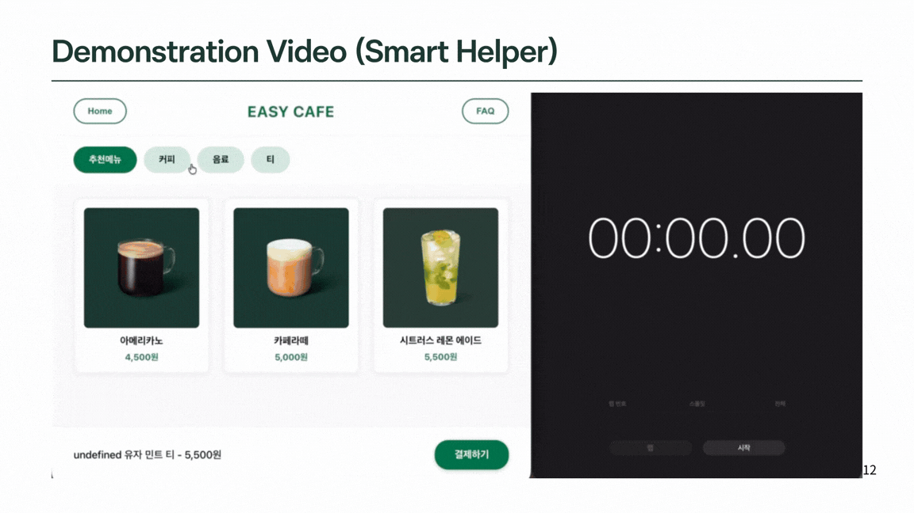
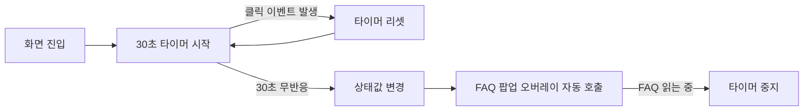

# 🖥 Frontend & Smart Helper

> 담당: 김예지 · [← 프로젝트 전체 README로 돌아가기](../README.md)

EASY CAFE 키오스크의 **프론트엔드 화면 구성**과 **스마트 헬퍼 모듈**을 담당했습니다.

<!-- TODO: 스마트 헬퍼 시연 GIF -->
<!--  -->

---

## 1. 스마트 헬퍼 (Smart Helper)

### 해결하려던 문제
키오스크 앞에서 어떻게 해야 할지 몰라 멈춰 있는 사용자는, 바쁜 시간대에는 직원의 도움을 받기 어렵습니다. 사용자가 "도와주세요"라고 직접 요청하기 전에 **시스템이 먼저 막힌 상태를 감지해 탈출구를 제공**하는 것이 목표였습니다.

### 동작 방식



1. 사용자의 모든 클릭 이벤트를 구독합니다.
2. 클릭이 발생할 때마다 타이머를 리셋합니다.
3. 30초 동안 이벤트가 없으면 '화면 정체·주문 포기 상태'로 간주하고 상태값을 변경합니다.
4. 상태값 변화에 따라 도움 모듈(FAQ 팝업)이 큰 안내 문구와 함께 전체 화면 오버레이로 나타납니다.
5. 사용자가 FAQ를 읽는 동안에는 타이머를 멈춰 팝업이 다시 겹치지 않도록 했습니다.

### 구현 포인트
- **React `useEffect` 타이머**: 이벤트 구독과 정리(cleanup)로 타이머를 관리
- **상태 기반 렌더링**: 타이머 만료 → 상태 변경 → 도움 모듈 동적 호출
- **기존 FAQ 모듈 재사용**: 새 화면을 만들지 않고 FAQ 팝업을 자동 트리거로 호출

<!-- TODO: 실제 구현 코드 중 핵심 20줄 내외를 붙여넣으세요. 예: useEffect, 타이머 리셋, 만료 시 setState -->

```jsx
// 예시 구조입니다. 실제 코드로 교체하세요.
useEffect(() => {
  const timer = setTimeout(() => setShowHelper(true), 30000);
  window.addEventListener("click", resetTimer);
  return () => {
    clearTimeout(timer);
    window.removeEventListener("click", resetTimer);
  };
}, [/* 의존성 */]);
```

### 한계와 개선 방향
| 한계 | 개선 방향 |
|---|---|
| 모든 사용자에게 동일하게 30초 적용 | 화면별 타이머 시간 차등 적용 |
| 팝업 기준이 '시간'에만 한정 | 사용자 행동 패턴 분석 |
| 도움이 '시각'에만 한정 | 음성 안내 추가 |

---

## 2. 프론트엔드

### 화면 구성
| 화면 | 설명 |
|---|---|
| 첫 화면 | 매장 / 포장 선택 |
| 메뉴 탐색 | 추천메뉴, 커피, 음료, 티 카테고리 탭과 메뉴 카드, 하단 주문 바 |
| FAQ 팝업 | 자주 묻는 질문, 실시간 인기 TOP 3, 카테고리별 인기 1위 배지 |
| 바코드 인식 | 카메라 화면과 안내 문구 |
| 결제·주문 완료 | 할인 적용 내역, 추가 결제 안내, 주문 완료 화면 |

<!-- TODO: 화면별 스크린샷을 넣고, 본인이 직접 구현한 화면만 남기세요 -->

### 설계 시 신경 쓴 점
- 처음 보는 사람도 헤매지 않도록 카테고리 탭 기반의 단순한 메뉴 구조
- 큰 안내 문구와 오버레이로 막힌 순간의 탈출구를 명확히 제공
- 백엔드 API와 비동기로 통신해 FAQ 조회수, 인기 순위를 새로고침 없이 반영

<!-- TODO: 상태 관리 방식, 컴포넌트 구조, API 연동 방식 등을 2~3줄로 추가 -->

---

## 3. 트러블슈팅 · 배운 점

<!--
포트폴리오에서 가장 중요한 섹션입니다. 아래 형식으로 1~3개 작성하세요.

### 문제: (예: 클릭 이벤트가 중복 등록되어 타이머가 여러 개 생김)
- 원인:
- 해결:
- 결과 / 배운 점:
-->

## 4. 사용 기술

React · JavaScript · <!-- TODO: 사용한 스타일링, 라우팅, HTTP 클라이언트 등 -->

## 5. 폴더 구조

<!-- TODO: 본인 담당 폴더만 간단히 -->

```
frontend/
├── src/
│   ├── components/
│   ├── pages/
│   └── ...
```
