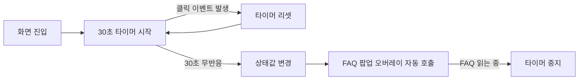

# 🖥 Frontend & Smart Helper

> 담당: 김예지 · [← 프로젝트 전체 README로 돌아가기](../README.md)

EASY CAFE 키오스크의 **프론트엔드 화면 구성**과 **스마트 헬퍼 모듈**을 담당했습니다.

[smart-helper](./images/smart-helper.gif)

---

## 1. 스마트 헬퍼 (Smart Helper)

### 해결하려던 문제
키오스크 앞에서 어떻게 해야 할지 몰라 멈춰 있는 사용자는, 바쁜 시간대에는 직원의 도움을 받기 어렵습니다. 사용자가 "도와주세요"라고 직접 요청하기 전에 **시스템이 먼저 막힌 상태를 감지해 탈출구를 제공**하는 것이 목표였습니다.

### 동작 방식



1. 사용자의 모든 클릭 이벤트를 구독합니다.
2. 클릭이 발생할 때마다 타이머를 리셋합니다.
3. 30초 동안 이벤트가 없으면 '화면 정체·주문 포기 상태'로 간주하고 상태값을 변경합니다.
4. 상태값 변화에 따라 도움 모듈(FAQ 팝업)이 큰 안내 문구와 함께 전체 화면 오버레이로 나타납니다.
5. 사용자가 FAQ를 읽는 동안에는 타이머를 멈춰 팝업이 다시 겹치지 않도록 했습니다.

### 구현 포인트
- 화면에 진입하면 `useEffect` 안에서 `setTimeout`으로 30초 타이머를 시작
- 30초 동안 FAQ를 열지 않으면 상태값(`showFAQ`)을 변경해 FAQ 팝업을 자동으로 호출
- FAQ가 열려 있는 동안에는 타이머를 걸지 않고, 컴포넌트가 사라질 때 `clearTimeout`으로 타이머를 정리

### 핵심 코드

`frontend/src/MenuScreen.js`

```jsx
// 30초 동안 FAQ를 열지 않으면 도움 팝업을 자동으로 띄운다
useEffect(() => {
  if (showFAQ) return;                 // FAQ가 열려 있으면 타이머를 걸지 않음
  const timer = setTimeout(() => {
    setShowFAQ(true);                  // 30초 뒤 상태값 변경 → FAQ 팝업 렌더링
  }, 30000);
  return () => clearTimeout(timer);    // 화면을 벗어나거나 상태가 바뀌면 타이머 정리
}, [showFAQ]);
```

- `showFAQ` 상태가 `false`일 때만 30초 타이머가 시작됩니다.
- 타이머가 끝나면 `setShowFAQ(true)`로 상태가 바뀌고, 상태 변화에 따라 FAQ 팝업이 렌더링됩니다.
- 클린업 함수(`clearTimeout`)로 타이머가 중복 생성되거나 화면을 떠난 뒤에도 남는 것을 막습니다.

### 한계와 개선 방향
| 한계 | 개선 방향 |
|---|---|
| 모든 사용자에게 동일하게 30초 적용 | 화면별 타이머 시간 차등 적용 |
| 팝업 기준이 '시간'에만 한정 | 사용자 행동 패턴 분석 |
| 도움이 '시각'에만 한정 | 음성 안내 추가 |

---

## 2. 프론트엔드

### 화면 구성
| 화면 | 설명 |
|---|---|
| 첫 화면 | 매장 / 포장 선택 |
| 메뉴 탐색 | 추천메뉴, 커피, 음료, 티 카테고리 탭과 메뉴 카드, 하단 주문 바 |
| 바코드 인식 | 카메라 화면과 안내 문구 |
| 결제·주문 완료 | 할인 적용 내역, 추가 결제 안내, 주문 완료 화면 |

[첫화면](.docs/images/mainscreen.png)
[메뉴탐색](.docs/images/menuscreen.png)
[결제·주문 완료](.docs/images/paymentscreen.png)

### 설계 시 신경 쓴 점
- 처음 보는 사람도 헤매지 않도록 카테고리 탭 기반의 단순한 메뉴 구조
- 큰 안내 문구와 오버레이로 막힌 순간의 탈출구를 명확히 제공
- 백엔드 API와 비동기로 통신해 FAQ 조회수, 인기 순위를 새로고침 없이 반영

### 구조와 상태 관리
- 화면 단위로 컴포넌트를 나누어 구성 (`HomeScreen`, `MenuScreen`, `PaymentScreen`, `BarcodeScreen`, `BarcodeCameraScreen`)
- 팝업 표시 여부는 `useState`로 관리하고, 스마트 헬퍼 타이머는 `useEffect`로 처리
- FAQ 팝업은 모달 안에 백엔드(Flask, `127.0.0.1:8000`)가 제공하는 FAQ 페이지를 `iframe`으로 불러와 표시
- 조회수 증가와 인기 순위 갱신은 FAQ 페이지 쪽에서 백엔드 API(`/update_click`)를 호출해 처리하고, 프론트엔드는 이 화면을 팝업으로 띄우고 호출 시점(스마트 헬퍼 트리거 포함)을 담당

---

## 3. 트러블슈팅 및 배운 점

### 🚨 문제 1: 바코드 카메라 화면 진입 시 에러 발생
**`Cannot stop, scanner is not running or paused`**
* **원인**
  * 개발 모드(React StrictMode)로 인해 `useEffect`가 두 번 실행됨.
  * 카메라가 아직 시작되지 않았거나 이미 멈춘 `html5-qrcode` 스캐너에 `stop()`을 호출하여 에러 발생.
* **해결**
  * `useRef`를 사용하여 시작 여부(`isStarted`)를 상태로 저장해 중복 실행 방지.
  * `stop()` 호출에 `.catch()`를 붙여 이미 멈춘 상태에서도 에러가 전파되지 않도록 예외 처리.
  * 개발 중에는 `index.js`의 StrictMode를 해제하여 이중 실행 방지.
* **결과 및 배운 점**
  * 에러 없이 카메라 화면이 열리고, 바코드 인식 후 결제 화면으로 정상 전환됨.
  * 카메라와 같은 외부 장치 자원은 생명주기(시작, 정지, 정리)를 직접 엄격하게 관리해야 함을 배움.
  * `useEffect`의 cleanup 함수와 React 개발 모드의 이중 실행 간의 관계를 깊이 이해함.

---

### 🚨 문제 2: 자동 FAQ 팝업이 의도치 않게 사라지는 문제
* **원인**
  * 모든 사용자에게 동일한 30초 대기 시간을 일괄 적용.
  * 컨테이너의 `onMouseMove` 이벤트에 팝업 닫기 핸들러를 연결해, 도움이 필요한 사용자가 마우스를 조금만 움직여도 FAQ가 사라짐.
* **해결**
  * `onMouseMove` 이벤트를 제거하고, **'X' 버튼**을 눌러야만 팝업이 닫히도록 로직 수정.
  * 팝업이 떠 있는 동안에는 타이머가 돌지 않도록 `useEffect` 내에 조건 처리 추가 (`if (showFAQ) return`).
  * 팝업 내용 영역 클릭 시 닫히는 것을 막기 위해 `stopPropagation` 적용.
* **결과 및 배운 점**
  * 한 번 노출된 FAQ는 사용자가 직접 닫을 때까지 안정적으로 유지됨.
  * 사용자 행동에 반응하는 UI는 **어떤 이벤트를 트리거로 사용할지**가 실사용성을 크게 좌우함을 배움.
  * *(한계 및 개선 방향)* 현재는 고정된 시간 기준이라 사용자가 실제로 어려움을 겪고 있는지 판단하기 어려움. 향후 화면별 시간 차등 적용 및 행동 패턴(뒤로 가기 반복 등) 감지 로직으로 확장할 계획.

---

### 🚨 문제 3: 바코드 라이브러리 호환성 및 웹캠 인식 실패
* **원인**
  * 초기 검토한 `react-qr-reader` 라이브러리가 React 18 환경에서 호환성이 불안정함.
  * 라이브러리 교체 후에도 특정 브라우저(Edge)에서 카메라 장치가 가상 카메라(Mirametrix Virtual Camera)로 우선 잡혀 실제 영상 입력이 안 됨.
* **해결**
  * 바코드 인식 라이브러리를 `html5-qrcode`로 전면 교체.
  * 브라우저의 사이트 권한 설정에서 카메라 장치를 노트북 내장 카메라로 수동 변경.
* **결과 및 배운 점**
  * 웹캠을 통한 바코드 실시간 인식 기능이 정상적으로 구현됨.
  * 오픈소스 라이브러리 선정 시, **사용 중인 프레임워크 버전과의 호환성 및 최근 유지보수 업데이트 상태**를 최우선으로 확인해야 함을 느낌.
  * 코드 레벨의 오류로 보이는 증상도 실제로는 브라우저 권한이나 OS의 하드웨어 장치 설정 문제일 수 있다는 점을 깨달음.
 

## 4. 사용 기술

| 구분 | 기술 | 사용한 곳 |
|---|---|---|
| 프레임워크 | React (Create React App, `react-scripts`) | 키오스크 화면 구성 |
| 언어 | JavaScript (JSX) | 화면 컴포넌트, 스마트 헬퍼 로직 |
| 상태·타이머 | React Hooks (`useState`, `useEffect`), `setTimeout` | 팝업 표시 상태 관리, 30초 무반응 타이머 |
| 화면 연동 | `iframe` | 백엔드(Flask)가 제공하는 FAQ 페이지를 모달 팝업으로 표시 |
| 협업 연동 | Flask, Supabase (팀원 담당) | FAQ 데이터 제공, 조회수 갱신 |

## 5. 폴더 구조

```text
AI-/
└── frontend/
    ├── public/
    │   ├── favicon.ico
    │   ├── index.html
    │   └── ...
    └── src/
        ├── data/
        │   └── menuData.js
        ├── pages/
        │   ├── BarcodeCameraScreen.jsx 
        │   ├── BarcodeScreen.jsx 
        │   ├── CompleteScreen.jsx 
        │   ├── HomeScreen.jsx
        │   ├── MenuScreen.jsx
        │   └── PaymentScreen.jsx
        ├── App.js
        ├── index.js
        └── ... (css 및 기타 설정 파일)
